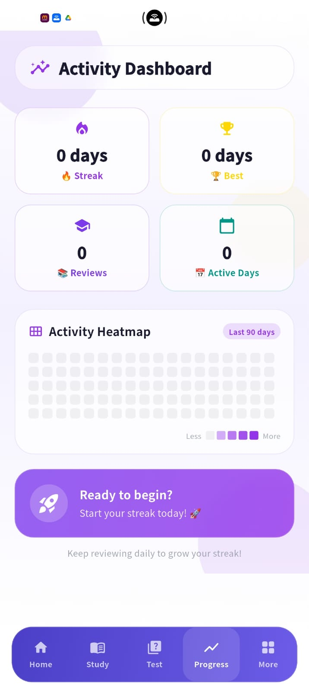
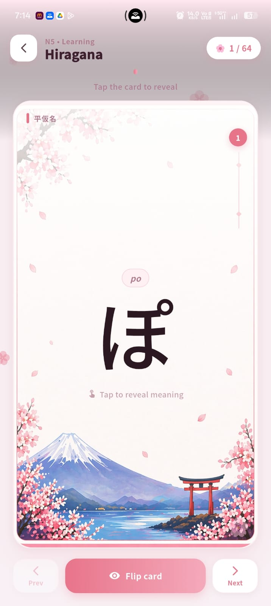
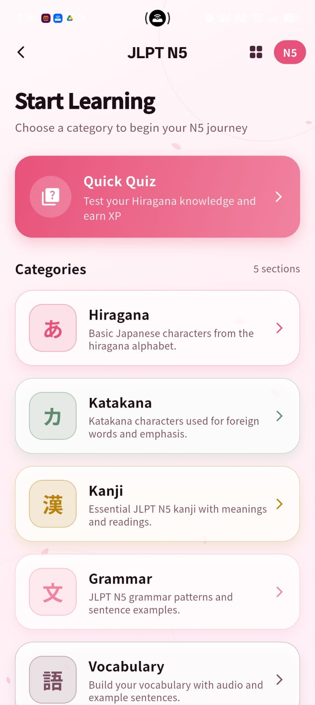

# 🇯🇵 Japanese Learning App (JLPT N5)

A simple and powerful Android app built with Flutter to help beginners learn **JLPT N5 Japanese** in a structured and engaging way.

---

## 📱 Features

* 📚 Complete **N5 Kanji**
* 🧠 Daily **Vocabulary Practice**
* ✍️ Easy-to-understand **Grammar**
* 🎯 **Daily Quiz** (auto-generated every day)
* 📊 Track your **learning progress**
* 🎨 Clean and user-friendly UI

---

## 🚀 Tech Stack

* Flutter
* Dart
* Nest Js

---

## 📦 APK Download

👉 Download the latest APK here:
(Add your Google Drive link here)

---

## 📸 Screenshots






---

## 🛠️ Installation (For Developers)

```bash
git clone https://github.com/your-username/your-repo-name.git
cd your-repo-name
flutter pub get
flutter run
```

---

## 📁 Project Structure

```bash
lib/
 ├── screens/
 ├── widgets/
 ├── models/
 ├── services/
 └── main.dart
```

---

## 🎯 Purpose

This app is designed for beginners who are preparing for the **JLPT N5 exam** and want a simple, daily practice tool.

---

## 🔥 Future Improvements

* 🔊 Audio pronunciation
* 🌐 Multi-language support
* 🧑‍🏫 Advanced JLPT levels (N4, N3)
* ☁️ Cloud sync

---

## 🤝 Contributing

Feel free to fork this repo and improve it. Pull requests are welcome!

---

## 👨‍💻 Author

**Praveen Kumar**
Flutter Developer | Japanese Learner 🇯🇵

---

## ⭐ Support

If you like this project, give it a ⭐ on GitHub!
